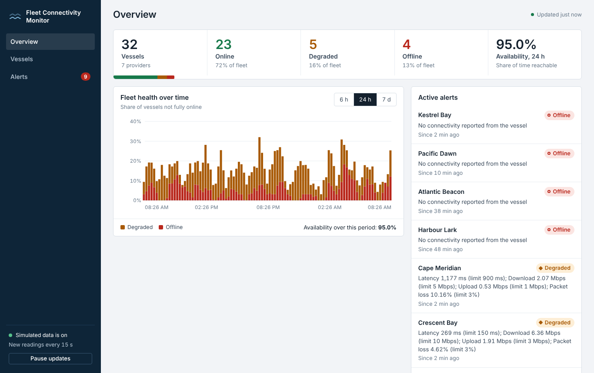

# Fleet Connectivity Monitor

A small web application for watching the satellite and cellular connections of a vessel fleet from one place. It shows which vessels are online, degraded or offline, how good each link is (latency, download, upload, packet loss), raises alerts when something goes wrong, and keeps history so you can see trends and availability.

There are no real provider integrations. A built-in simulator produces readings, so the dashboard is alive from the first start.



## Quick start

You need **Node.js 22.13 or newer**. Nothing else: no database server, no build step, and no native modules to compile (the database is Node's built-in `node:sqlite`). The only npm dependency is Express.

```bash
npm install
npm start
```

Open http://localhost:3000

On the first start the app creates a SQLite database in `data/`, adds 32 demo vessels and replays 7 days of history (takes about 4 seconds). After that, a new reading arrives for every vessel every 15 seconds.

```bash
npm test          # 39 tests, no setup needed
npm run reset     # delete the database; the next start seeds a fresh one
npm run dev       # restart on file changes
```

### Settings

All optional, set as environment variables (see `.env.example`).

| Variable | Default | Meaning |
|---|---|---|
| `PORT` | 3000 | HTTP port |
| `DB_PATH` | `data/vessels.db` | SQLite file |
| `SIMULATOR` | on | `off` stops generating readings |
| `SIM_INTERVAL_MS` | 15000 | Time between simulated readings |
| `SIM_VOLATILITY` | 1.5 | How often vessels change state. Raise it for a busier demo |
| `SEED_HISTORY_DAYS` | 7 | History generated on first start |
| `RETENTION_DAYS` | 7 | Raw readings older than this are deleted |

## What it does

| Requirement | Where to find it |
|---|---|
| Vessel master | **Vessels** page. Add, edit and delete vessels with name, IMO, call sign, type, flag, provider and technology. IMO numbers are checked with the real check-digit rule. |
| Dashboard | **Overview**: total, online, degraded, offline, 24 h availability, a fleet health chart, active alerts, and breakdowns by technology and provider. Every tile links to the matching filtered list. |
| Network metrics | Per vessel on the list and in detail: latency, download, upload, packet loss. The detail page marks any metric that is outside its limit. |
| Alerts | **Alerts** page and the red counter in the sidebar. Offline vessels and degraded links open an alert with the reason. Alerts close themselves on recovery, and can be acknowledged. |
| History and availability | Vessel detail: 1 h, 6 h, 24 h and 7 d charts for every metric, a status timeline, availability percentage, offline incidents and total time offline. |
| Backend | Node.js, Express, SQLite (`node:sqlite`). REST API listed below. |
| Frontend | Responsive, works down to phone width. Search, filters, sorting and paging on the vessel list. Filters are kept in the URL. |
| Data simulation | `server/services/simulator.js`, described below. |

## Architecture

```
 Browser (vanilla JS modules, SVG charts)
        │  JSON over HTTP, polls every 15 s
        ▼
 ┌───────────────────────── Express app (server/app.js) ─────────────────────────┐
 │  routes/        thin: read the request, validate parameters, call a service   │
 │  services/      business logic and SQL                                        │
 │     vessels  analytics  alerts        ingest  ◄──────────  simulator          │
 │  domain/        pure rules: thresholds per technology, classify(), IMO check  │
 └───────────────────────────────────┬───────────────────────────────────────────┘
                                     ▼
                              SQLite (node:sqlite)
```

The layering is deliberate and small:

- **domain** has no I/O. `classify(reading, technology)` is the only place that decides whether a link is online, degraded or offline. It is covered by unit tests.
- **services** own the SQL. Routes never build queries.
- **ingest** is the single door for readings. Whether a reading comes from the simulator or from a future provider adapter, it goes through `recordSample()`, which classifies it, stores it, updates the vessel's current state and opens or closes alerts, all in one transaction.
- **simulator** is just a producer. Replacing it with real provider polling would not touch anything else.

### Data model

```
providers 1───* vessels 1───1 vessel_status        (current state, one row per vessel)
                  │
                  ├──* connectivity_samples        (append-only readings)
                  └──* alerts                      (opened_at, resolved_at, acknowledged_at)
```

- `vessel_status` is kept apart from the sample log so the fleet table does not have to scan history to show "now".
- Offline samples store `NULL` metrics instead of zeros, so averages are not dragged down by outages.
- A partial unique index (`alerts(vessel_id, type) WHERE resolved_at IS NULL`) means the database itself refuses a second open alert of the same type for a vessel. This is covered by a test.
- Deleting a vessel cascades to its status, samples and alerts.

### How a status is decided

Thresholds depend on the technology, because "normal" is very different between them. A geostationary VSAT link at 650 ms is healthy; a Starlink-class link at 650 ms is not. Limits live in `server/domain/technologies.js` and are returned by `/api/meta`, so the UI shows the same numbers the server uses.

| Technology | Degraded when latency above | download below | upload below | loss above |
|---|---|---|---|---|
| LEO | 150 ms | 30 Mbps | 5 Mbps | 2% |
| VSAT Ku | 900 ms | 5 Mbps | 1 Mbps | 3% |
| VSAT Ka | 900 ms | 8 Mbps | 1.5 Mbps | 3% |
| L-band | 1400 ms | 0.15 Mbps | 0.1 Mbps | 5% |
| 4G/LTE | 150 ms | 10 Mbps | 3 Mbps | 3% |

A vessel with no link is **offline**. Alerts: offline is *critical*, degraded is *warning*, and the alert text lists every metric that is out of bounds with its value and limit.

### How availability is calculated

Availability is the share of time a vessel was not offline (degraded still counts as reachable). It is calculated per time bucket and then averaged, so the 2-minute seeded history and the 15-second live readings carry the same weight. Fleet availability is the same calculation across all vessels. The 24 h figure on the vessel list is cached for 30 seconds because it scans a day of readings.

### The simulator

Each vessel moves between three conditions: good, impaired and down, using fixed per-hour transition rates (a small Markov chain). Over time the fleet settles at roughly 85% healthy, 10% degraded, 5% down. On top of that:

- Readings are built from each technology's own baseline with random noise, plus a small evening dip in throughput.
- An impaired link breaks one or more of its thresholds (latency, throughput, loss or a mix). The simulator does not label anything as degraded; the classifier decides, so the two cannot disagree.
- A vessel picks up where the database left off after a restart.
- The history is generated with a fixed random seed, so every install looks the same. Three scripted incidents are started shortly before "now" so a fresh demo already has live problems.
- Raw readings older than `RETENTION_DAYS` are deleted hourly. Alerts are kept.

The sidebar has a pause/resume button, and every vessel page has **Take offline / Degrade link / Restore** buttons that force a condition for a few minutes. These are demo helpers and are the only reason `/api/simulator` exists.

## REST API

All responses are JSON. Errors look like `{ "error": { "code", "message", "fields?" } }`.

| Method and path | Purpose |
|---|---|
| `GET /api/meta` | Providers, technologies with thresholds, vessel types |
| `GET /api/dashboard/summary` | Counts by status, 24 h availability, open alerts, by provider, by technology |
| `GET /api/dashboard/trend?range=` | Fleet online/degraded/offline share over time. `range`: `6h`, `24h`, `7d` (also `1h`) |
| `GET /api/vessels` | List. Query: `search`, `status`, `providerId`, `technology`, `sort`, `order`, `page`, `pageSize` |
| `POST /api/vessels` | Create (201). `422` with per-field messages, `409` on duplicate IMO |
| `GET /api/vessels/:id` | One vessel with current status and metrics |
| `PUT /api/vessels/:id` | Update |
| `DELETE /api/vessels/:id` | Delete (204) |
| `GET /api/vessels/:id/history?range=` | Bucketed points for charts plus a summary (availability, averages, incidents, time offline) |
| `GET /api/alerts` | Query: `state` (`active`, `resolved`, `all`), `type`, `vesselId`, `page`, `pageSize` |
| `POST /api/alerts/:id/acknowledge` | Mark as acknowledged |
| `GET /api/simulator`, `POST /api/simulator/pause`, `/resume`, `/vessels/:id/force` | Demo controls |
| `GET /api/health` | Liveness |

The vessel list sorts offline first, then degraded, then online, unless a sort is chosen. Sort columns are checked against a whitelist and all values are passed as SQL parameters.

## Project layout

```
server/
  index.js            start-up: open DB, seed, start simulator, listen
  app.js              builds the Express app (also used by the tests)
  config.js           environment settings
  db/                 schema.sql, connection, seed data and history backfill
  domain/             technologies (thresholds), classify, IMO validation
  services/           ingest, simulator, vessels, analytics, alerts
  routes/             one file per resource
  lib/                errors, query parsing, time ranges, seeded random
public/
  index.html, css/styles.css
  js/                 main.js (router), api.js, format.js
  js/views/           dashboard, vessels, vessel-detail, vessel-form, alerts
  js/ui/              dom helper, shared components, SVG charts
tests/                node:test, 39 tests
```

## Decisions and trade-offs

- **SQLite instead of Postgres.** Zero setup for a reviewer, still fully relational with foreign keys, checks and indexes. The SQL is plain and portable; moving to Postgres means swapping `server/db/connection.js` and a couple of bucket expressions.
- **`node:sqlite` instead of a native driver.** An earlier version used `better-sqlite3`, but native modules can fail to install on machines without build tools. The built-in module removes that risk. The price is Node 22.13+ and a driver that Node still labels experimental, so `package.json` silences that one warning. `connection.js` is a 60 line adapter that adds plain-object rows and nestable transactions.
- **No front-end framework or build step.** The UI is a few ES modules. It starts instantly and every line is readable. For a larger product I would pick a framework; for this size it would mostly add tooling. All text is inserted with `textContent`, never `innerHTML`.
- **Hand-written SVG charts.** Four small chart types are cheaper than a charting library, work offline, and let the latency and packet-loss charts draw the threshold line.
- **Polling instead of WebSockets.** Data changes every 15 seconds, so a 15 second poll is the simplest thing that is correct. Server-sent events would be the natural next step.
- **Timestamps are epoch milliseconds.** Bucketing for charts is integer division in SQL, and the API returns ISO strings.
- **Tests concentrate on the rules.** Classification, alert lifecycle and the API contract are tested; presentation code is not.

## Known limitations and what I would do next

- No authentication or roles. The simulator endpoints would not exist in production.
- Alerts are per vessel and per type. There is no notification channel (email, Teams) and no repeat or escalation rules.
- Samples are kept at full resolution for 7 days. A longer history would need hourly roll-up tables.
- Status needs one reading to change. A real system would usually require several bad readings in a row before alerting, to avoid flapping.
- Next steps I would take: server-sent events, a provider adapter interface that feeds `recordSample()`, a map view using vessel positions, SLA reports per provider, and Docker plus Azure deployment.
